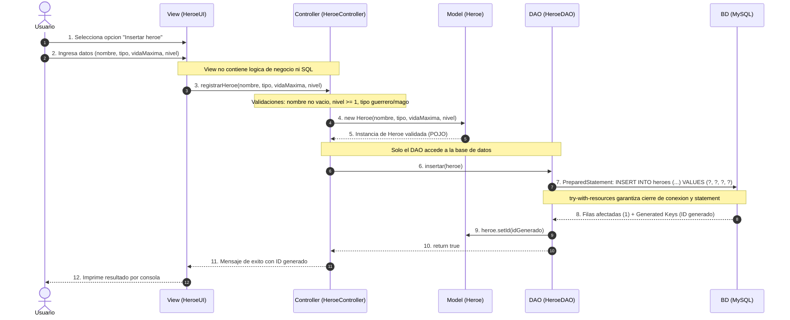
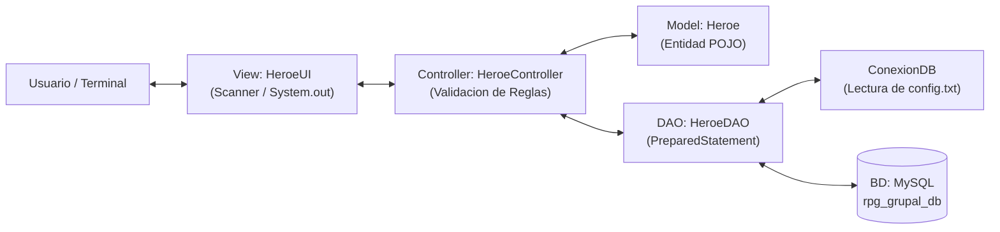

# Diagrama de Flujo MVC: "Insertar Heroe"
Unidad 5.2 - Simulador RPG (JDBC + MVC)

Este documento describe el flujo completo de ejecucion para la operacion **Insertar Heroe** respetando la separacion estricta de responsabilidades del patron **MVC (Model-View-Controller)** y el patron **DAO (Data Access Object)**.

---

## 1. Diagrama de Secuencia



---

## 2. Diagrama de Bloques de Arquitectura



---

## 3. Descripcion Paso a Paso del Flujo

1. **Capa Vista (`HeroeUI`)**:
   - Solicita por teclado los campos del nuevo heroe: `nombre`, `tipo` (1. Guerrero, 2. Mago), `vidaMaxima` y `nivel`.
   - No contiene ninguna sentencia SQL ni referencias a `java.sql`.
   - Transfiere los valores primitivos al controlador invocando `controller.registrarHeroe(...)`.

2. **Capa Controlador (`HeroeController`)**:
   - Aplica las reglas de negocio:
     - Nombre no vacio ni en blanco.
     - Tipo normalizado a minúsculas y validado (`guerrero` o `mago`).
     - Vida maxima $> 0$.
     - Nivel $\ge 1$.
   - Si alguna validacion falla, retorna un mensaje explicativo a la Vista sin consultar la base de datos.
   - Si es valido, instancia el modelo `Heroe` y delega la persistencia al DAO mediante `heroeDAO.insertar(heroe)`.

3. **Capa Modelo (`Heroe`)**:
   - Objeto POJO plano que encapsula las propiedades del heroe con atributos privados y getters/setters validados.

4. **Capa de Acceso a Datos (`HeroeDAO` y `ConexionDB`)**:
   - `ConexionDB` obtiene la conexion leyendo de forma segura las credenciales de `config.txt` (archivo en `.gitignore`).
   - `HeroeDAO` prepara la sentencia parametrizada con `PreparedStatement` evitando inyeccion SQL:
     ```sql
     INSERT INTO heroes (nombre, tipo, vida_maxima, nivel) VALUES (?, ?, ?, ?);
     ```
   - Asigna los parametros con `ps.setString(...)` y `ps.setInt(...)`.
   - Ejecuta `ps.executeUpdate()`.
   - Recupera el ID autogenerado con `ps.getGeneratedKeys()` y lo asigna al objeto.
   - Todo recurso (`Connection`, `PreparedStatement`, `ResultSet`) se cierra de manera automatica mediante `try-with-resources`.

5. **Respuesta a la Vista y al Usuario**:
   - El DAO retorna `true` al Controlador.
   - El Controlador construye el mensaje final: `"Heroe 'Arthur' registrado exitosamente con ID 1."`
   - La Vista presenta el mensaje en consola sin tildes.
